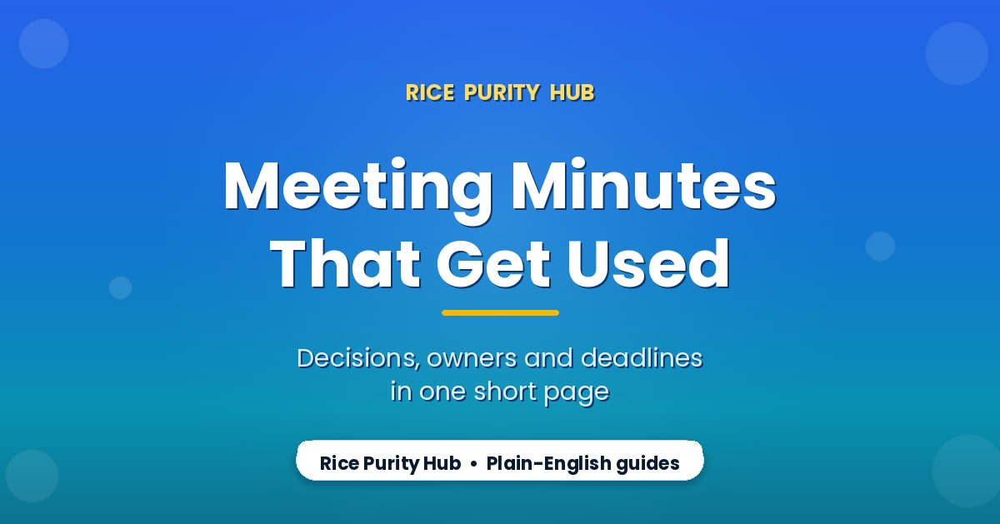
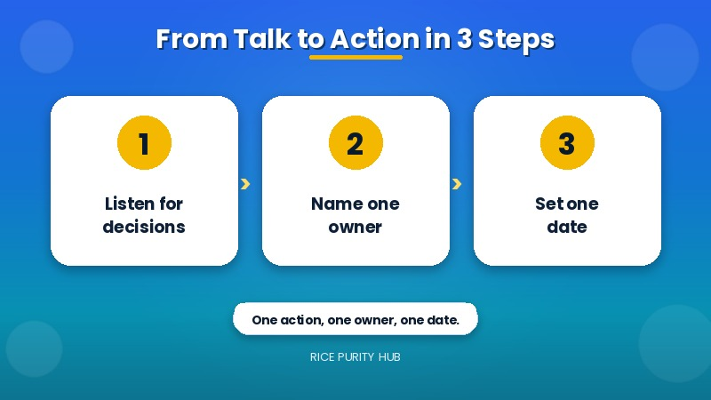
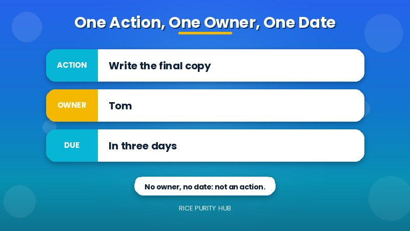

# How Small Teams Write Meeting Minutes That Get Used

**A meeting ends, everyone nods, and a week later nobody can agree on what was decided. The fix is not a longer document. It is a shorter one, written for the reader who was not in the room, sent the same day, and stored where the team can find it again. This guide shows how small teams write [minutes of meeting](https://www.ricepurityhub.com/how-to-write-meeting-minutes/) that people actually read, trust, and act on, and how to keep those minutes alive inside [knowledge base software](https://www.ricepurityhub.com/knowledge-base-software/) so one good decision does not vanish into a chat thread.**

Most minutes fail for a simple reason. They are written as a record of the meeting, not as a tool for the work after it. The writer tries to capture the discussion, so the document grows long, the decisions hide in the middle, and the actions have no owner and no date. Readers open it once, cannot find what they owe, and never open it again. The next meeting then starts from scratch, because nobody trusts the record from the last one.

Minutes that get used flip that order. They start from the reader. A teammate who missed the meeting should be able to read the page in two minutes and answer three questions: what was decided, what do I have to do, and when is it due. If the document answers those three questions clearly, it will be read. If it does not, no amount of careful formatting will save it.

## What Meeting Minutes Are

Meeting minutes are the official written record of a meeting. They are not a transcript, and they are not a diary of the discussion. A transcript tries to keep every word. Minutes do the opposite. They keep the result and leave out the talk that led to it.

A useful test makes the difference clear. Imagine a team argued for twenty minutes about a launch date and then agreed on a single date. The transcript needs twenty minutes of argument. The minutes need one line: the launch date is the agreed date. Everything else in that argument was the road to the decision, and the road does not need to be preserved.

That distinction matters more in a small team than in a large one. A small team has no spare person to chase down missing decisions. When the record is short and clear, the work moves. When the record is long and vague, the same questions come back in the next meeting, and the team pays for the same discussion twice.

Minutes also settle memory. Two people can leave the same meeting with two different versions of what was agreed, and both can be sure they are right. A written record, shared the same day, ends that argument before it starts. It is proof of what was decided, a catch up for anyone who was absent, and a list of tasks that can be checked, not just remembered.

## Why Most Minutes Go Unread

Before fixing minutes, it helps to name the four ways they usually fail. Each one is small on its own, and each one is enough to make readers stop opening the document.

The first failure is recording everything except the decisions. Pages of discussion with no outcomes are worse than a short record, because readers give up before they find the one line that matters. Summarize the talk and feature the result.

The second failure is actions with no owner and no deadline. A line that says someone should look into a problem is not an action, it is a wish. Every task needs one named person and one real date attached to it. If either part is missing, the task will drift until someone else picks it up or it is forgotten.

The third failure is sending the minutes a week late. Memory fades fast, and people quietly build their own versions of what was agreed. Minutes that arrive a week later confirm almost nothing. The same day is best, and the next day is the latest useful moment.

The fourth failure is writing opinions as if they were facts. A line that judges a decision tells future readers what the writer thought, not what the team decided. Write it neutrally instead. Future readers should learn what happened, not what the minute taker thought about it.

Notice what these four failures share. None of them is about grammar or formatting. All of them are about whether the reader can act on the document. That is the standard to hold every set of minutes to: can a reader who missed the meeting find each decision and each action in seconds.

## How to Write Minutes That Get Used

The method below is built for a small team, and it takes less time than the longhand approach it replaces. It has three parts: prepare before the meeting, listen for outcomes during it, and finish the record the same day.

### Step 1. Write the meeting promise in one sentence

Before the meeting, write down what the meeting must deliver, in one plain sentence. A meeting, like a product, needs a clear promise, and the discipline is the same one used to write a [value proposition](https://www.ricepurityhub.com/value-proposition/): name who it is for, what problem it solves, and what result it must deliver. If you cannot write that sentence, the meeting does not have a clear job yet, and the minutes will not either.

A good promise sounds like this: by the end of this meeting, we will choose one homepage design and name the person who prepares the final files. A weak promise sounds like this: we will discuss the homepage. The first version tells the minute taker exactly what to listen for. The second version tells them nothing.

### Step 2. Prepare the template before anyone sits down

Open a blank template and fill in the header before the meeting begins: the meeting title, the time, the attendee list, and anyone who is absent. List the agenda items in order, with a short space under each one for a decision and an action.

Preparation also means reading the agenda and the supporting documents, and bringing the last meeting's minutes. Start with a quick check of the open actions from last time. Which ones are done, and which ones need a new deadline? That two minute review is where follow through actually happens, because it turns the last meeting's actions into this meeting's first agenda item.

### Step 3. Listen for decisions, not for discussion

During the meeting, your job is not to type fast. It is to listen for the moments when talk turns into a decision or a task. Note the actual start time, who is present, and who is absent, then work down the agenda in order, giving each topic its own short section.

For every topic, listen for three things. The decision, stated as one plain sentence, ideally in bold so it is easy to scan. The actions, each with what will be done, one named owner, and a deadline. And the open points, where a topic ends without a decision. Say so honestly. An honest open point is useful. A blank space is not.

When a task is named but the owner or the date is missing, ask out loud: who is taking that, and by when? People expect the question, and asking it makes the meeting clearer for everyone in the room, not just for the record.

### Step 4. Capture rough notes, then clean them up

Do not try to write polished sentences live. Capture rough notes and key words during the discussion, mark each decision with a star, and clean everything up right after the meeting. Trying to produce the final document in real time is exactly how important details get missed.

Disagreements need care in this stage. Summarize them briefly and neutrally: who proposed what, and what the group finally chose. Do not record sarcasm, side comments, or your own view of who argued best. Minutes are a record, not a review.

### Step 5. Finish and send them the same day

Write the minutes up the same day, while the discussion is still fresh, and double check names, numbers, and dates. Send them to everyone, including the people who were absent. A short message with the minutes attached or linked is enough. Share them where the team actually works, not buried in a private email thread. If someone spots an error, they can say so, and corrections made in the first day are painless.

### Step 6. Turn every action into a tracked task

Copy every action out of the minutes and into the plan or task list where it stays visible until it is done. An action that lives only in the minutes will be read once and forgotten. An action that lives in the shared plan gets checked at the next meeting, and that check is what makes the minutes matter.

### Step 7. Store the minutes where they can be found again

Minutes earn their keep months after a meeting, so save them in the shared space the team uses for project files, not in a personal folder. A decision nobody can find later might as well not have been recorded. Keep one master copy per project, with clear names, so the record of a decision is easy to find and impossible to confuse with an older draft.

## A Worked Example

The example below is fictional, written to show the shape of minutes that get used. It is short, clear, and focused on decisions and actions. Notice how little of the actual conversation appears. That is the point. A reader who was not in the room still knows what was decided, who owes what, and when it is due.

**Weekly Sync, Website Redesign**

**Attendees:** Priya (lead), Marco, Sara, Tom. **Absent:** Lena. **Minutes taken by:** Priya.

**1. Homepage designs.** Sara presented two homepage designs. The team compared them and chose design B, because the pricing section is easier to find.

**Decision:** Design B approved. Sara prepares the final files.

**2. Launch date.** The original launch date clashes with a company event. The team agreed to move the launch by one week.

**Decision:** New launch date is one week later than the original date.

| Action | Owner | Due |
|---|---|---|
| Write the final homepage copy | Tom | In three days |
| Book a user testing session | Priya | In six days |
| Send the updated timeline to the client | Marco | Tomorrow |

**Next meeting:** One week later, at the same time.

**Open point:** The testing budget is not decided yet. The team needs the cost figures first.

Read that example as a reader would. The decisions are bold and easy to scan. Every action has one owner and one date. The open point is stated honestly instead of being hidden. The whole document can be read in under two minutes, and a teammate who missed the meeting knows exactly where things stand.

Now compare it with a version that fails the test. Imagine the same meeting written as three pages of discussion, with the launch date buried in the middle, the copy task assigned to "the team", and no due date on the testing session. That version contains more words and less information. It is the version nobody opens a second time.

## Where Minutes Live After the Meeting

A set of minutes has two lives. The first life is the day it is sent, when it tells everyone what was decided and what they owe. The second life is months later, when someone needs to know why a decision was made, or whether a task was ever finished. Most teams plan for the first life and forget the second, so their minutes pile up in inboxes and shared drives where no search can find them.

The cure is to treat minutes as part of the team's memory, not as a message. That is where the knowledge base idea earns its place. A team that stores its minutes in a searchable library, next to its guides and decisions, can answer a question in seconds instead of asking the one person who remembers. The library does not need to be fancy. It needs a search box, clear categories, and one home for every record, so a decision from months ago is as findable as a guide written last week.

The habit that keeps the library honest is a monthly check. Once a month, someone reads the list of open actions from recent minutes and asks which ones are done, which ones need a new date, and which ones were never started. That check turns the minutes from a pile of documents into a living record. Without it, even the best written minutes go quiet, because nobody is watching whether the actions in them actually happen.

There is a useful parallel here. A product team keeps one correct record of a product from its first sketch to the day it is retired, and that discipline is called [product lifecycle management](https://www.ricepurityhub.com/product-lifecycle-management/). Minutes deserve the same treatment at a smaller scale: one product, one record, and every team working from the same correct version of the truth. A meeting decision is a smaller thing than a product, but the failure is the same. When the record splits into copies, one copy goes stale, someone works from the old version, and real time and trust are lost.

## Why This System Works

The system in this guide works because it respects how small teams actually behave. It does not ask anyone to write more. It asks them to write less, sooner, and in the same shape every time.

First, the same day rule respects memory. Rough notes make sense to the writer right now. In three days, half of the abbreviations will be a mystery. Cleaning the notes into the template while the discussion is still fresh keeps the record accurate, and sharing it within a day lets the team correct errors while they are still painless.

Second, the one owner rule respects accountability. A task with two owners has no owner, because each person assumes the other will do it. A task with no date has no urgency, because it can always be done tomorrow. One name and one date turn a wish into a commitment that can be checked.

Third, the consistent template respects the reader. When every set of minutes looks the same, the team learns exactly where to find things, in seconds. The header is always at the top, the decisions are always bold, the action table is always in the same place. Readers do not have to learn a new layout for every meeting, so they keep opening the document.

Fourth, the storage habit respects the future. A decision that can be found months later is still useful. A decision that cannot be found is not a decision at all, it is a memory, and memories differ. Storing minutes in one shared, searchable home is what turns a good habit into lasting value.

None of this needs new software or a new process. It needs a named minute taker, a template, a same day deadline, and a shared home for the finished record. Teams that hold those four habits find that their meetings get shorter, because the second meeting no longer has to repeat the first, and their arguments get rarer, because the record settles them.

For more plain English guides on the habits that keep a small team moving, browse [Rice Purity Hub](https://www.ricepurityhub.com/).

## Conclusion

Minutes that get used are not the longest minutes, and they are not the most detailed. They are the minutes that answer three questions in two minutes: what was decided, who owes what, and when it is due. They are written from a template, finished the same day, shared with everyone including the absent, and stored where the team can find them again.

Start with the meeting promise, listen for decisions during the meeting, and turn every action into a tracked task with one owner and one date. Store the record in one shared home, check the open actions once a month, and let the minutes do the quiet work of keeping the team honest. Do that consistently, and meetings stop evaporating. Every decision has a home, every task has an owner, and nobody has to rely on memory.

## Frequently Asked Questions

**What is the difference between meeting minutes and meeting notes?**

Meeting minutes are the official, structured record of a meeting: the decisions made, the action items, and who owns them. Meeting notes are informal personal jottings, taken in any format, mostly for the note taker's own use. Minutes are shared and kept as the team's record. Notes usually are not.

**How long should meeting minutes be?**

As short as they can be while still covering every decision and action. For a one hour team meeting, one to two pages is typical. If readers can find each decision and each action in seconds, the length is right. Long, transcript style minutes usually mean too much of the discussion was recorded.

**Who should take meeting minutes?**

One person, agreed before the meeting starts. In a small team the job often rotates, and in formal settings it is often the secretary or the meeting organizer. The key rule is that minute taking is a real task, so it should belong to a named person, not to whoever happens to open a notebook.

**How soon should minutes be sent?**

The same day is best, and the next day is the latest useful moment. Minutes that arrive a week later confirm almost nothing, because people have already built their own versions of what was agreed.

**Should minutes record everything that was said?**

No. Minutes record outcomes, not conversations. Keep the decision, the actions with owners and dates, and the honest open points. Leave out the long debate, personal opinions, side comments, and anything that does not help a reader act or remember a decision.

**What do you do with a meeting that ends without a decision?**

Say so honestly in the minutes, and name what is needed before a decision can be made. An honest open point is useful. A blank space is not, because the next meeting will start without knowing what was missing.

**Are recordings and AI note tools a replacement for minutes?**

No. A recording or an AI summary is a draft, not a record. Software can mishear names and numbers, miss the moment a decision changed, or present a suggestion as if the group had agreed to it. A person still has to read the draft, fix the decisions, confirm every owner and deadline, and take responsibility for the final document.

## References

- Rice Purity Hub, How to Write Meeting Minutes: Steps, Template and Example, https://www.ricepurityhub.com/how-to-write-meeting-minutes/
- Rice Purity Hub, Knowledge Base Software: What It Is and How to Choose, https://www.ricepurityhub.com/knowledge-base-software/
- Rice Purity Hub, Product Lifecycle Management: What PLM Is and How It Works, https://www.ricepurityhub.com/product-lifecycle-management/
- Rice Purity Hub, Value Proposition: What It Is and How to Write One, https://www.ricepurityhub.com/value-proposition/
- Rice Purity Hub, https://www.ricepurityhub.com/

---
